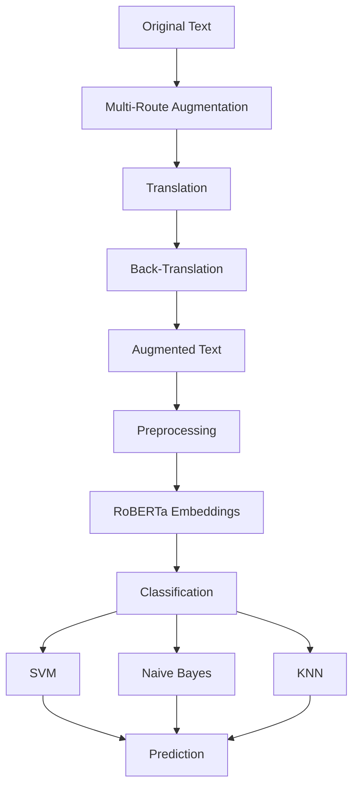

# Sentiment Analysis and Data Augmentation System

This project combines a multi-route translation data augmentation system with a sentiment analyzer that utilizes RoBERTa embeddings and multiple classifiers for comprehensive emotion detection.

## System Pipeline



## Features

### Data Augmentation
- Bidirectional translation through multiple linguistic routes
- Batch processing for efficiency
- Multi-language back-translation pipeline

### Sentiment Analysis
- Contextual embeddings from `PlanTL-GOB-ES/roberta-base-bne`
- Multiple classifier ensemble:
  - **SVM** (optimized parameters: C=7.21, gamma=0.6069, kernel=rbf)
  - **Gaussian Naive Bayes**
  - **KNN** (n_neighbors=6)
- Data balancing with SMOTE technique
- Cross-validation for robust evaluation
- Random search hyperparameter optimization

### Text Processing
- Advanced cleaning and normalization
- Lemmatization using spaCy (es_core_news_sm)
- Spanish-specific stopword removal
- Special character and accent handling
- RoBERTa-based tokenization

### Evaluation and Metrics
- 5-fold cross-validation
- Confusion matrices
- Detailed classification reports
- Per-model performance metrics
- Execution time tracking
- Interactive visualizations

### Sentiment Categories
- **Joy** (questions 1, 6)
- **Sadness** (question 2)
- **Stress** (questions 3, 9)
- **Anxiety** (questions 4, 5)
- **Fear** (questions 7, 10)
- **Anger** (question 8)

## Installation

### 1. Clone the Repository
```bash
git clone https://github.com/AsperSTS/simple_sentiment_analyzer_model.git
cd simple_sentiment_analyzer_model
```

### 2. Environment Setup

#### Using Anaconda (Recommended)
```bash
# Create environment from environment.yml
conda env create -f environment.yml

# Activate the environment
conda activate sentiment_analyzer_env
```

#### Using pip
```bash
# Install dependencies
pip install -r requirements.txt
```

### 3. Install Language Resources
```bash
python -m spacy download es_core_news_sm
```

## Usage

### Data Augmentation
First, ensure you have the normalized CSV file in UTF-8 encoding:

```bash
python back_translation.py
```

### Sentiment Analysis
Make sure your CSV has normalized columns:

```bash
python sentiment_analyzer.py
```

### Graphical Interface
Ensure all necessary dependencies are installed:

```bash
streamlit run use_model_gui.py
```

## Project Structure

```
project/
├── experiments/          # Experiment directory
├── best_models/         # Saved trained models
├── utils.py            # Utility functions and helpers
├── back_translation.py # Data augmentation module
├── sentiment_analyzer.py # Main analysis pipeline
├── use_model_gui.py    # Streamlit GUI interface
├── requirements.txt    # Project dependencies
├── environment.yml     # Conda environment file
└── README.md          # Project documentation
```

## System Requirements

- **Python**: 3.11+
- **RAM**: Minimum 8GB (16GB recommended for large datasets)
- **Storage**: 2GB+ free disk space
- **GPU**: Optional but recommended for faster processing

## Technical Details

### Model Architecture
- **Base Model**: Spanish RoBERTa from PlanTL-GOB-ES
- **Feature Extraction**: 768-dimensional embeddings
- **Classification**: Ensemble of three complementary algorithms
- **Data Balancing**: SMOTE for handling class imbalance

### Performance Optimization
- Batch processing for translation tasks
- Vectorized operations using NumPy and scikit-learn
- Memory-efficient data handling
- Parallel processing where applicable

### Data Pipeline
1. **Input Validation**: CSV format and encoding verification
2. **Text Preprocessing**: Cleaning, normalization, and tokenization
3. **Feature Extraction**: RoBERTa embedding generation
4. **Model Training**: Cross-validated training with hyperparameter tuning
5. **Evaluation**: Comprehensive metric calculation and visualization

## Contributing

This project is designed for research and educational purposes in natural language processing and sentiment analysis for Spanish text.

---

*NLP Research Project - Spanish Sentiment Analysis System*